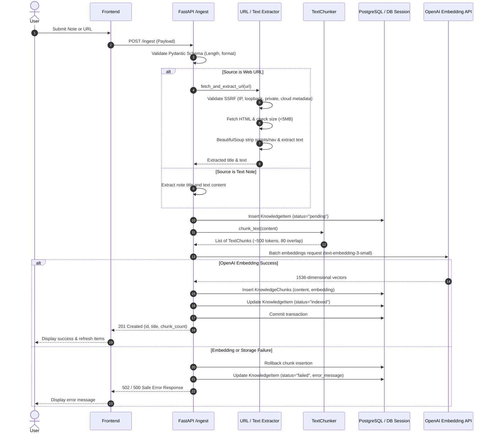
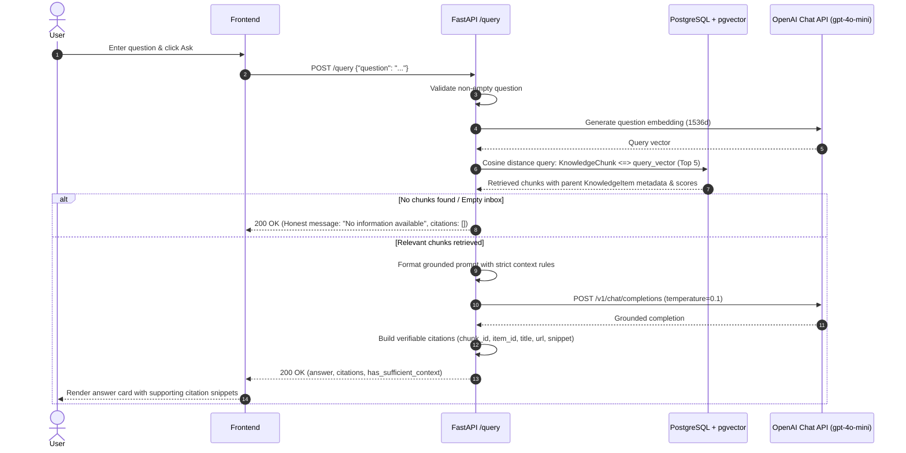

# DESIGN.md — Architecture & Technical Specifications

This document outlines the architectural decisions, component responsibilities, end-to-end data flows, database schemas, retrieval strategies, error handling patterns, and security protections implemented in **AI Knowledge Inbox**.

---

## 1. System Overview & Architecture

AI Knowledge Inbox is designed as a decoupled, production-minded monorepo consisting of:
1. **Next.js Frontend (App Router, React 19, TypeScript, Tailwind CSS)**: A reactive client providing user interfaces for content ingestion, inbox browsing, and grounded question answering.
2. **FastAPI Backend (Python 3.14+, SQLAlchemy 2.x, Pydantic, HTTPX, BeautifulSoup4)**: An asynchronous REST API responsible for SSRF-protected webpage extraction, recursive semantic chunking, OpenAI vector embeddings, vector similarity search, and RAG completion with citations.
3. **Database Layer (PostgreSQL with pgvector)**: Relational and vector storage using native HNSW cosine distance indexing (`<=>`), with an in-memory/SQLite fallback for automated test isolation.

```
                      +-----------------------------+
                      |     Next.js App Router      |
                      |   (React 19 + TypeScript)   |
                      +--------------+--------------+
                                     |
                       HTTP / JSON   |   CORS Protected
                                     v
                      +-----------------------------+
                      |       FastAPI Backend       |
                      |   (Async ASGI Application)  |
                      +--------------+--------------+
                                     |
         +---------------------------+---------------------------+
         |                           |                           |
         v                           v                           v
+-------------------+       +-------------------+       +-------------------+
|   URL Extractor   |       | Embedding / RAG   |       |  Database Access  |
|  (SSRF-Protected) |       |  (OpenAI SDK)     |       | (SQLAlchemy 2.x)  |
+-------------------+       +-------------------+       +-------------------+
         |                           |                           |
         |                           |                           v
         |                           |                  +-------------------+
         |                           |                  |  PostgreSQL 16+   |
         |                           |                  |    + pgvector     |
         +---------------------------+----------------->| (1536d HNSW Index)|
                                                        +-------------------+
```

---

## 2. Request Flows

### A. Ingestion Pipeline (`POST /ingest`)



### B. Query & Retrieval Pipeline (`POST /query`)



---

## 3. Database Models & Schema Design

Entity Relationship Diagram:

```
+-------------------------------------------------------------+
|                      KnowledgeItem                          |
+-------------------------------------------------------------+
| id: String(36) [PK, UUID]                                   |
| title: String(500)                                          |
| source_type: String(50) ("note" | "url")                    |
| original_content: Text                                      |
| original_url: String(2048) [Nullable]                       |
| created_at: DateTime(timezone=True) [Index]                 |
| indexing_status: String(50) ("pending" | "indexed" | "failed")|
| error_message: Text [Nullable]                              |
+-------------------------------------------------------------+
                              | 1
                              |
                              | has many (cascade delete)
                              v N
+-------------------------------------------------------------+
|                      KnowledgeChunk                         |
+-------------------------------------------------------------+
| id: String(36) [PK, UUID]                                   |
| item_id: String(36) [FK -> knowledge_items.id, ON DELETE]   |
| chunk_index: Integer                                        |
| content: Text                                               |
| embedding: Vector(1536) [pgvector]                          |
| created_at: DateTime(timezone=True)                         |
+-------------------------------------------------------------+
| Indexes:                                                    |
| - ix_knowledge_chunks_item_index (item_id, chunk_index)     |
| - ix_knowledge_chunks_embedding_hnsw (HNSW vector_cosine_ops)
+-------------------------------------------------------------+
```

### pgvector Integration & Dialect Adaptability
- In PostgreSQL, the column uses `Vector(1536)` provided by `pgvector.sqlalchemy`. An HNSW index (`USING hnsw (embedding vector_cosine_ops)`) provides sub-millisecond approximate nearest neighbor searches as the database grows.
- A custom `VectorType` TypeDecorator bridges dialects: on PostgreSQL it renders as native `Vector(1536)`, and on SQLite (used for automated unit testing) it transparently maps to `JSON`, allowing unit tests to run anywhere with 100% independence from external database services.

---

## 4. Chunking & Embedding Strategy

- **Chunk Size**: Approximately 500 tokens (~2,000 characters).
- **Chunk Overlap**: Approximately 80 tokens (~320 characters).
- **Semantic Boundary Preservation**: The chunker splits recursively on semantic delimiters in hierarchy:
  1. Double newlines (`\n\n` - paragraphs)
  2. Single newlines (`\n` - lines/bullet points)
  3. Sentence terminators (`. `, `? `, `! `, `; `)
  4. Word boundaries (` `)
  5. Fallback character boundary
- **Short Document Handling**: Notes shorter than the target chunk size are indexed immediately as a single chunk without arbitrary fragmentation.
- **Batching & Dimension Checking**: The `EmbeddingService` batches inputs (up to 64 items per request) and asserts that every vector matches `1536` dimensions before database persistence.

---

## 5. Grounded RAG & Citation Strategy

To prevent hallucinations and guarantee auditability:
1. **Strict System Prompt**: The system prompt instructs the model to answer exclusively based on the provided context and never extrapolate or use outside knowledge.
2. **Honesty on Insufficient Evidence**: If the retrieved snippets lack the facts required to answer the prompt, the model is explicitly instructed to reply:
   *"The saved knowledge does not provide enough information to answer this question."*
   The backend inspects this condition and sets `has_sufficient_context = false`.
3. **Verifiable Citations**: Every citation contains:
   - `chunk_id` and `item_id` (foreign key trace to exact database rows)
   - `title` of source
   - `source_type` ("note" or "url")
   - `url` (original web address when applicable)
   - `snippet` (first 280 characters of chunk content)
   - `similarity_score` (cosine similarity score)

---

## 6. Security & SSRF Protection

Direct URL ingestion presents severe Server-Side Request Forgery (SSRF) vulnerabilities if unmanaged. The backend enforces defense-in-depth:
1. **Scheme Whitelist**: Accepts only `http` and `https`.
2. **Disallowed Hostnames**: Rejects `localhost`, `127.0.0.1`, `0.0.0.0`, `::1`, `metadata.google.internal`, and other internal names.
3. **DNS Pre-Resolution Validation**: Resolves domain names via `socket.getaddrinfo` before connection and verifies that all resolved IP addresses are safe public addresses using Python's `ipaddress` library:
   - Blocks private ranges (`10.0.0.0/8`, `172.16.0.0/12`, `192.168.0.0/16`, `fc00::/7`)
   - Blocks link-local ranges (`169.254.0.0/16`, `fe80::/10`)
   - Blocks loopback (`127.0.0.0/8`, `::1`)
   - Blocks cloud metadata endpoint (`169.254.169.254`)
4. **Controlled Redirect Revalidation**: Disables automated HTTP client redirect following. Each redirect destination is parsed and re-evaluated against all SSRF rules before following (capped at 3 redirects).
5. **Payload Limits**: Rejects payloads exceeding 5 MB to prevent memory exhaustion attacks.
6. **Content-Type Filter**: Rejects non-HTML binary files (executables, zip files, media).
7. **No Secret Leaks**: Exception handlers filter out raw stack traces and credentials.
